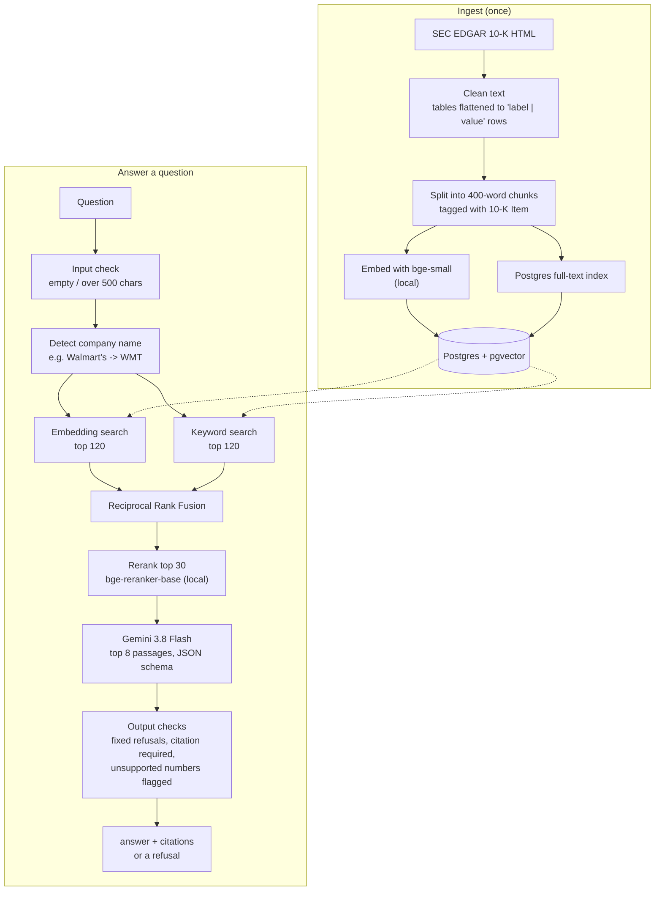

# Ask the Filings

Ask a question about a company's annual report (SEC 10-K) and get an answer along with the exact
passages it came from. If the filings don't contain the answer, it says so instead of guessing.

I built this to learn how to make a retrieval system that is measurably good, not just one that
demos well. Every design choice below was kept or dropped based on the eval.

## Results

144 questions over 10 companies' 10-Ks (two fiscal years each): 117 that the filings answer and 27
that they don't. The question doesn't say which company or year to search; the system works that
out itself.

| | |
|---|---|
| **Correct answers** | **111 / 117 (95%)**, 95% CI roughly 89-98% |
| Wrong answers | **0**. The other 6 were "not found in the retrieved passages" replies |
| Main figure correct, checked in code | 65 / 67 numeric questions (the 2 misses are refusals) |
| Answers whose numbers all appear in the cited passages | 112 / 112 |
| Unanswerable questions correctly refused | 26 / 27 |
| Guardrail tests passed | 21 / 21 |
| Cost per question | $0.007 (answer + grading, `gemini-3.8-flash`) |
| Latency | 5.5 s median, 8.7 s p95 |

Unanswerable questions by type, all refused except one:

| Type | Example | Refused |
|---|---|---|
| Company not loaded | "What was Intel's gross margin in 2025?" | 6 / 6 |
| Year not loaded | "What was Apple's total net sales in fiscal 2015?" | 6 / 6 |
| Prediction | "What will NVIDIA's total revenue be in fiscal 2030?" | 5 / 5 |
| Not disclosed | "How many iPhone units did Apple sell in fiscal 2025?" | 4 / 4 |
| False premise | "Why did Apple discontinue the iPhone in fiscal 2025?" | 5 / 6 |

The one false-premise "miss" answered that the premise is wrong and quoted iPhone sales growing 4%
to $209.6 billion. I count it as a miss to keep the metric strict.

How much each part of the search contributes (did the right passage make the top 8?):

| Search | Company/year given | Realistic: company detected from the question |
|---|---|---|
| Embeddings only | 0.68 | 0.60 |
| Keywords only (Postgres full-text) | 0.82 | 0.68 |
| Hybrid (both, merged with RRF) | 0.80 | 0.74 |
| **Hybrid + reranker (default)** | **0.90** | **0.89** |
| Hybrid + reranker, no company detection | | 0.77 |

Keyword search beats the embedding model here (bge-small doesn't handle numbers and line items
well), and the cross-encoder reranker does most of the work. Correct answers (95%) come out higher
than retrieval recall (89%) because many facts appear in both years' filings.

**Caveats.** The answerable questions were drafted by Gemini from passages of the filings and
Gemini also grades the answers, which tends to be generous; numbers are also checked in code to
offset that. Every question passes automatic checks (the quote exists in the filing, the answer's
numbers appear in the quote, the company is named, no duplicates), but the human review
(`make review`) isn't finished yet.

## Guardrails

| Where | What it does |
|---|---|
| Before the model | Rejects empty questions and questions over 500 characters |
| In the prompt | Retrieved filing text is marked as data, never instructions |
| Model output | Each request is labelled as a filing question, investment advice, a prediction or off-topic; anything but a filing question gets a fixed refusal written in code, not by the model |
| After the model | An answer without a valid citation is withheld; numbers not found in the cited passages are shown as a warning |
| Demo page | 20 questions per session |

The guardrail eval (`evals/guardrail_cases.jsonl`) covers investment advice, off-topic requests,
instructions hidden in the question, and fake passages with hidden instructions slipped into the
search results. Before adding the guardrails, Gemini already handled the first 18 cases correctly;
the guardrails make refusals consistent and add checks that don't depend on the model behaving.
The test checker itself needed fixing twice: a correct refusal like "there is no record that Tesla
went bankrupt" contains the words it was looking for, so forbidden phrases now only count when the
system actually answers.

## How it works



Embedding and reranking run locally, so the only paid call is the final Gemini request.

## Run it

Needs Python 3.11+, [uv](https://docs.astral.sh/uv/) and Docker.

```bash
make setup     # installs dependencies and creates a blank .env
               # then fill in GEMINI_API_KEY and SEC_USER_AGENT in .env
make db        # Postgres + pgvector in Docker
make ingest    # downloads 10 companies x 2 years of 10-Ks (re-runs skip what's already loaded)
make demo      # web page at http://localhost:8501
```

The demo page shows the answer, the cited passages, and a link to the original filing on EDGAR.

## Eval

```bash
make eval-retrieval    # retrieval metrics only, no API calls
make eval              # answers + grading for all 144 questions (about $1)
make guardrails        # the 21 guardrail cases (about $0.15)
make check-questions   # automatic checks on the question set, no API calls
make review            # go through the questions by hand: y = correct, n = wrong
make questions         # draft more questions with Gemini, then check and review them
uv run python evals/compare.py <run A>.jsonl <run B>.jsonl
```

`compare.py` checks whether one configuration really beats another, using a paired McNemar test
and a bootstrap confidence interval over the per-question results.

## What I tried

- **Keyword search bug.** My first version required every word of the question to appear in a
  chunk, so it found nothing for most questions (recall 0.23 on an earlier 60-question set).
  Matching any word fixed it (0.77).
- **Rerankers.** `ms-marco-MiniLM-L-6-v2` gave no gain (it's trained on short web snippets).
  `bge-reranker-base` was the biggest single improvement. Reranking 50 candidates instead of 30
  was slower and no better.
- **Company detection.** Without it, similar wording from other companies crowds out the answer.
  Plain rules (company names and tickers) took realistic recall from 0.77 to 0.88. Also detecting
  the year made things slightly worse.
- **Table-aware chunking.** I noticed about half of the 400-word chunks are longer than the 512
  tokens the embedder and reranker can read. I built a chunker that sizes chunks in tokens and
  keeps tables whole, repeating headers when a table has to be split:

  | Chunker | Company/year given | Realistic |
  |---|---|---|
  | 400 words (kept) | 0.89 | 0.88 |
  | 400 tokens | 0.92 | 0.88 |
  | 400 tokens, table-aware | 0.93 | 0.90 |

  Slightly ahead everywhere, but not significant (realistic: fixed 9, broke 7, p = 0.80), so I
  didn't switch. On my first, smaller question set it had looked like an 8-point win. That's why
  the eval now has more questions and `compare.py` exists. It's still available with
  `CHUNKER=tokens_tables`.
- **Fairer questions.** The first questions were generated from chunks, which favours whatever
  chunker produced them, and often didn't name a company. They're now generated from raw filing
  text, must name the company, and are paraphrased so they don't just reuse the filing's words.

## Limitations

- When a question names a year but not a filing, search can pick up the wrong year's table
  (e.g. Walmart's FY2026 advertising costs answered from the FY2025 filing).
- Section labels are approximate; some financial statements get tagged with the wrong Item.
- Questions that compare years or companies aren't handled specially yet.
- The guardrail set is small (21 cases), so it shows the basics work, not that the system is
  hard to attack.

## Next

- Finish the hand review of the question set.
- Add a judge from a different model family and compare it with my own labels.
- Add a short header (company, year, section) to each chunk before embedding.
- Split multi-year and multi-company questions into one search per filing.
- Deploy the demo (Cloud Run + Neon) with rate limits and a spending cap.

## Project layout

| Path | What it does |
|---|---|
| `src/filings/ingest.py` | Downloads 10-Ks from EDGAR, chunks, embeds and stores them |
| `src/filings/chunking.py` | HTML to text, table flattening, the chunkers |
| `src/filings/embed.py`, `rerank.py` | Local embedding model and cross-encoder reranker |
| `src/filings/retrieve.py` | Embedding, keyword, hybrid and reranked search |
| `src/filings/query_parse.py` | Finds the company named in a question |
| `src/filings/answer.py`, `llm.py` | Builds the prompt and calls Gemini with a JSON schema |
| `src/filings/guardrails.py`, `numbers.py` | Input checks, fixed refusals, number matching for checks and evals |
| `app/streamlit_app.py` | Demo page |
| `evals/` | Question set, guardrail cases, eval runners, question review tool, paired comparison |
| `tests/` | Unit tests (offline, no API key needed) |
